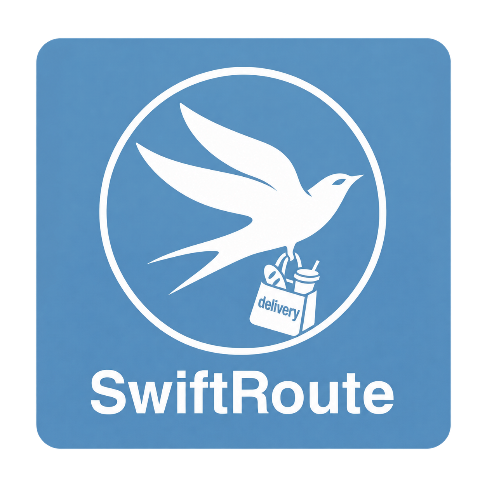

<div align="center">



# SwiftRoute

**От поръчката до доставката — избор на куриер и маршрутизация върху реална пътна мрежа.**

### [Отвори уеб приложението ↗](https://swiftroute-bg.vercel.app/)

Ученически проект в категория **„Разпределени приложения“**.

React · TypeScript · FastAPI · PostgreSQL · Dijkstra · A*

</div>

---

## За журито и посетителите

**Приложението е достъпно онлайн:** [https://swiftroute-bg.vercel.app/](https://swiftroute-bg.vercel.app/).
Не е необходимо да инсталирате Python, PostgreSQL или други инструменти. Разделът за локално стартиране по-долу е предназначен за разработчици.

За работа с поръчки е необходим одобрен акаунт. Регистрацията на ресторант или куриер се одобрява от администратор. Данните за демонстрационен достъп се предоставят отделно от автора.

**Примерен сценарий за демонстрация:**

1. Ресторант създава поръчка с координати за доставка в покрития район на Пловдив.
2. При възлагане системата избира свободния куриер с най-малко изчислено време до ресторанта чрез **Дийкстра**.
3. На картата се разглеждат маршрутите до ресторанта и от ресторанта до клиента; вторият се изчислява чрез **A***.
4. Куриерът приема поръчката, отбелязва вземането ѝ и завършва доставката.
5. Поръчката получава статус „Доставена“, а куриерът отново става свободен.

## Идея и предназначение

SwiftRoute свързва ресторанти и куриери в обща уеб платформа. Ресторантът подава поръчка, а системата подпомага разпределянето ѝ според наличността на куриерите и времето за придвижване по пътната мрежа. Куриерите работят със собствени профили, без зависимост от интеграция с външна платформа за доставки.

Основният технически акцент е съчетаването на **два самостоятелно реализирани графови алгоритъма** с реални географски данни, сървърна логика, постоянна база данни и интерактивна карта. Изборът на куриер отчита пътните връзки и посоките им, вместо да сравнява единствено разстоянията по права линия.

## Функционалности

| Област | Реализирани възможности |
|---|---|
| Акаунти | Вход, изход, регистрация с административно одобрение и отделни потребителски роли. |
| Поръчки | Създаване, списъци и филтриране по състояние, възлагане и проследяване на статуса. |
| Куриери | Наличност, редакция на координатите и работа с възложени поръчки. |
| Разпределяне | Избор на свободен и достижим куриер според изчисленото време до ресторанта. |
| Маршрути | Изчисляване и показване на маршрут до ресторанта и маршрут до клиента чрез Leaflet. |
| Администрация | Управление на потребителите, одобрение на регистрации и активиране/деактивиране на акаунти. |
| Съхранение | Данните за профили, поръчки и сесии се пазят в PostgreSQL. |

Поръчките преминават последователно през:

**Очаква куриер → Възложена → Приета → В доставка → Доставена**

Сървърът проверява допустимите преходи. Куриер с активна поръчка не може да бъде обявен за свободен чрез ръчна промяна на наличността.

### Потребителски роли

| Роля | Предназначение |
|---|---|
| Ресторант | Създава и управлява поръчките на своя ресторант. |
| Куриер | Управлява собствената си наличност и местоположение и обработва възложените му поръчки. |
| Администратор | Управлява акаунтите и има общ преглед върху работата на платформата. |

Проверките за роли и достъп до конкретни записи се извършват и в backend-а.

## Алгоритми и пътна мрежа

### Представяне на мрежата

Данните са от **OpenStreetMap** и се обработват с **OSMnx**. Пътната мрежа се моделира като ориентиран претеглен граф: върховете са пътни възли, а ребрата — допустими отсечки. Теглото на всяко ребро е оценено време в секунди:

```text
време = дължина в метри / (скорост в km/h / 3.6)
```

Посоките на ребрата се запазват. При успоредни ребра между едни и същи върхове алгоритмичният речник съхранява минималното време. Подготвената тестова мрежа съдържа **1937 върха и 4336 ребра**, представени като **4331 връзки** след това обединяване.

### Дийкстра — кой куриер да поеме поръчката?

Търсим времето **от всеки свободен куриер до един ресторант**. Вместо да изпълняваме отделно търсене за всеки куриер, обръщаме всички ребра, запазваме теглата им и изпълняваме Дийкстра веднъж от върха на ресторанта:

```text
разстояние в обърнатия граф(ресторант, куриер)
    = разстояние в оригиналния граф(куриер, ресторант)
```

Алгоритъмът избира непосетения връх с най-малка текуща оценка и подобрява времената до съседите му. След приключването се сравняват оценките на свободните куриери. Избира се този с най-малко крайно време; недостижимите кандидати остават с безкрайна оценка и не се избират.

Тази организация запазва значението на еднопосочните улици. Реализацията избира минимума чрез обхождане и има сложност **O(|V|² + |E|)**. След изчислението сравнението на **K** куриери е **O(K)**. Теглата са неотрицателни.

### A* — как да стигнем от ресторанта до клиента?

Координатите на ресторанта и клиента се свързват с най-близките върхове на графа. A* насочва търсенето към целта чрез оценката:

```text
f(n) = g(n) + h(n)
g(n) = най-доброто намерено време от началото до n
h(n) = геодезично разстояние от n до целта / максимална скорост в мрежата
```

Разстоянието е в метри, а максималната скорост се преобразува в метри за секунда. Евристиката е долна граница на оставащото време, когато дължините на ребрата са поне преките разстояния между краищата им, а скоростите не превишават използвания максимум. При тези условия тя е консистентна и A* запазва оптималността спрямо зададените тегла.

При достигане на целта маршрутът се възстановява чрез записаните предшественици. Геометрията на пътните отсечки се преобразува в **GeoJSON**, който се визуализира върху картата. При липса на път се връща подходящо съобщение.

И тук минимумът се избира с обхождане; при консистентна евристика сложността е **O(|V|² + |E|)**. A* може да разгледа по-малко върхове, но не е непременно по-бърз при всяка заявка. При `h(n) = 0` търсенето следва принципа на Дийкстра.

**Кодът на алгоритмите:** [algorithms.py](backend/routing/algorithms.py) · [Обработка на пътната мрежа](backend/routing/road_network.py) · [Избор на куриер](backend/services/dispatch_service.py) · [Изчисляване на маршрути](backend/services/route_service.py)

OSMnx и NetworkX се използват за данните и графовата структура; реализациите на Дийкстра и A* са в кода на проекта.

## Технологии и архитектура

| Слой | Технологии и предназначение |
|---|---|
| Уеб интерфейс | React, TypeScript и Vite — компоненти, форми и взаимодействие с API. |
| Карта | Leaflet, GeoJSON и OpenStreetMap — визуализиране на пътната геометрия. |
| Backend | Python, FastAPI, Uvicorn и Pydantic — HTTP API, валидация и бизнес логика. |
| Географски данни | OSMnx и NetworkX — зареждане и обработване на пътния граф. |
| База данни | PostgreSQL, SQLAlchemy, Psycopg и Alembic — записи, транзакции и миграции. |
| Удостоверяване | Argon2id за паролите и сървърни сесии с HttpOnly cookie. |
| Публикуване | Vercel за frontend-а, Render за backend-а и Supabase за PostgreSQL. |
| Контрол на версиите | Git и GitHub. |

Браузърът изпраща заявки към `/api`. При публикуваната версия Vercel ги препраща към FastAPI в Render, който работи с PostgreSQL в Supabase. Backend-ът зарежда предварително подготвения GraphML файл; не се налага повторно изтегляне на пътната мрежа за всяка поръчка.

### Организация на кода

| Път | Съдържание |
|---|---|
| `backend/main.py` | FastAPI приложение и основни API операции. |
| `backend/core/` | Удостоверяване, права за достъп и настройки за сигурност. |
| `backend/db/` | Връзка с PostgreSQL и модели на таблиците. |
| `backend/routers/` | API маршрути за вход, регистрация и администрация. |
| `backend/schemas/` | Pydantic модели за входни и изходни данни. |
| `backend/services/` | Бизнес логика за поръчки, куриери, сесии и маршрути. |
| `backend/routing/` | Графови алгоритми и обработка на пътната мрежа. |
| `backend/data/` | Подготвена пътна мрежа в GraphML формат. |
| `backend/migrations/` | Alembic миграции. |
| `backend/scripts/` | Инициализация и помощни административни команди. |
| `frontend/src/` | React интерфейс, карта, профили и диспечърско табло. |

## Локално стартиране за разработчици

Следващите команди са за **Windows PowerShell** и нова локална инсталация. Използваната среда е Python **3.14** и Node.js **24**, с работещ PostgreSQL. Предварително създайте празна база `swiftroute` и потребител с права за създаване на таблици в нея.

### 1. Изтегляне и зависимости

```powershell
git clone https://github.com/ggosheto/SwiftRoute.git
cd SwiftRoute
py -m venv .venv
.\.venv\Scripts\python.exe -m pip install -r requirements-hosting.txt
```

`requirements-hosting.txt` включва основните зависимости, миграциите и библиотеките за акаунти.

### 2. Настройки на средата

Създайте файл `.env` в основната папка, до `alembic.ini`. Попълнете собствените си данни за **локалната** база:

```dotenv
DB_HOST=127.0.0.1
DB_PORT=5432
DB_NAME=swiftroute
DB_USER=swiftroute_app
DB_PASSWORD="YOUR_LOCAL_DATABASE_PASSWORD"
AUTH_COOKIE_SECURE=false
AUTH_ALLOWED_ORIGINS=http://localhost:5173,http://127.0.0.1:5173,http://localhost:8000,http://127.0.0.1:8000
```

`.env` е изключен от Git. За публикувана HTTPS среда се задава `AUTH_COOKIE_SECURE=true` и действителният адрес на frontend-а в `AUTH_ALLOWED_ORIGINS`; за използваната облачна PostgreSQL връзка — `DB_SSLMODE=require`.

### 3. База данни и първи администратор

От основната папка изпълнете последователно:

```powershell
.\.venv\Scripts\python.exe -m backend.scripts.check_database
.\.venv\Scripts\python.exe -m backend.scripts.init_database
.\.venv\Scripts\python.exe -m alembic upgrade head
.\.venv\Scripts\python.exe -m backend.scripts.user_accounts create --email admin@example.com --role admin
```

Инициализиращият скрипт създава основните таблици и начални демонстрационни профили; миграциите добавят структурите за акаунти, сесии и одобрение. Паролата на администратора се въвежда скрито в терминала — няма предварително зададена парола.

Това са инструкции за **нова база**. При обновяване на съществуваща инсталация се прилагат необходимите миграции, без повторно създаване на администратора.

### 4. Стартиране на backend-а

```powershell
.\.venv\Scripts\python.exe -m uvicorn backend.main:app --reload
```

API документацията е на [http://localhost:8000/docs](http://localhost:8000/docs). Проверката на сървъра е на [http://localhost:8000/health](http://localhost:8000/health); тя не замества проверката за връзка с базата.

### 5. Стартиране на frontend-а

Във **втори терминал**, от основната папка:

```powershell
cd frontend
npm ci
npm run dev
```

Отворете [http://localhost:5173](http://localhost:5173). Backend-ът и frontend-ът трябва да работят едновременно. Vite препраща локалните `/api` заявки към `127.0.0.1:8000`.

За проверка на TypeScript и създаване на версия за публикуване изпълнете `npm run build` от `frontend/`.

## Обхват на демонстрационната версия

- Пътната мрежа покрива **част от Пловдив**. За демонстрация използвайте координати в този район; привързването към най-близък възел не означава покритие извън него.
- Времената са **алгоритмични оценки**, без данни за трафик в реално време, изчакване в ресторанта или паркиране. „Най-бърз маршрут“ означава минимално време според зададените тегла.
- Графът е за автомобилно придвижване. Не се моделират всички ограничения на реалната навигация, например забрани за завой.
- Всеки куриер обслужва най-много една активна поръчка. Обединяване на няколко доставки не е реализирано.
- Проектът е състезателен прототип в активно развитие; липсват плащания и интеграции с външни доставчици на храна.

## Следващи стъпки

- Въвеждане на местоположение от устройството на куриера с негово разрешение.
- По-широко географско покритие и проверка дали адресът попада в обслужвания район.
- Калибриране на времевите оценки чрез реални измервания.
- Сравняване на броя обработени върхове и времето за изпълнение на двата алгоритъма; оптимизация с приоритетна опашка.

## Данни и авторство

Картографските данни са **© [OpenStreetMap contributors](https://www.openstreetmap.org/copyright)** и се предоставят съгласно Open Database License (ODbL). Атрибуцията се показва и върху картата в приложението.

SwiftRoute е разработено от Георги Георгиев и Петя Пашова, учиници от 11А клас от Професионалната гимназия по електротехника и електроника - гр. Пловдив. За въпроси и предложения: [GitHub Issues](https://github.com/ggosheto/SwiftRoute/issues).
